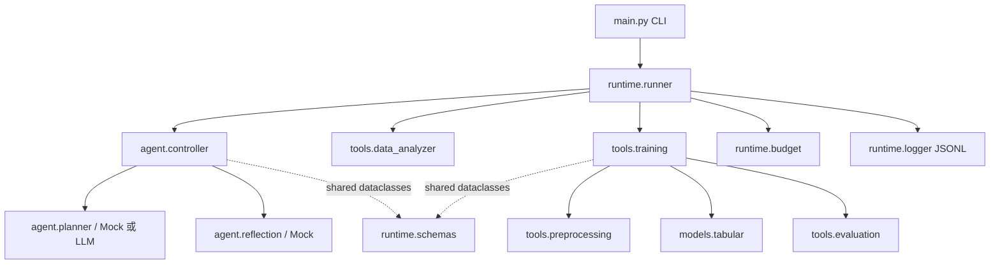

# AIAA3102 Final Project — General Algorithm SuperAgent

这是一个**开发阶段 MVP**：同一套接口接收分类任务配置、执行表格实验、评估并保存包含预处理的模型。默认使用固定 Mock Planner；显式启用开发模式后，已通过学校 API 验证 Qwen、DeepSeek 单次调用及 DeepSeek 反馈驱动的表格多轮实验。历史官方价格和 Token 上限尚未核验，正式模式仍关闭；开发结果不能作为课程正式评估结果。

## 课程要求摘要

以 `AIAA3102 - Final Project - Full Assignment Requirements.pdf` 为准；Preview 只作参考。课程要求一个 Agent 处理未知的 tabular、text、image 二/多分类任务，按每个任务公布的格式、划分和指标报告结果。不得使用数据集名称触发手工准备的特解。报告中的结果必须由冻结版本完整自主运行产生；运行期间不得人工改代码、指定下一实验或选择最终模型。指定 test 只能用于最终评估。

Agent 仅可使用截至 **2026-10-21** 正式发布的 Qwen/DeepSeek 模型；每个任务按当日**官方标准**输入/输出 Token 价格、实际用量计费，人民币 **20 元**封顶，不计缓存或优惠。所有模型调用、Token、成本、候选实验、结果和关键决定都必须留痕。最终提交还需源码与统一入口、依赖与说明、可运行预测方案及结果、报告 PDF、执行日志、AI 工具使用声明和 Presentation。未见任务必须使用冻结版本自主执行。

## 架构



`runtime.schemas` 定义单向共享契约：`TaskSpec`（模态、路径、显式目标列、指标、划分）、`ExperimentConfig`（算法、参数、种子、资源上限）、`ExperimentResult`（状态、验证指标、模型、耗时、错误）、`AgentDecision`（动作、理由、配置、停止条件）、`UsageRecord`（模型、Token、价格、成本）。Agent Core 与 ML Engine 不互相导入。

最小接口示例：

```python
from pathlib import Path
from runtime.schemas import TaskSpec, ExperimentConfig, AgentDecision

task = TaskSpec("tabular", Path("train.csv"), "label", "accuracy", "binary", validation_path=Path("val.csv"))
experiment = ExperimentConfig("logistic_regression", {"C": 1.0}, random_seed=42)
decision = AgentDecision("experiment", "开发基线", experiment)
```

## 环境

Python 3.11+。当前工作机使用已有的 Conda `coursework` 环境，依赖已齐全；缺包时在**该环境**安装：

```powershell
conda activate coursework
python -m pip install -r requirements.txt
```

若 PowerShell 尚未启用 `conda activate`，可用 `conda run -n coursework python main.py ...`。不需建立项目虚拟环境。API Key 从环境变量读取，参考 `.env.example`；默认 Mock 不调用模型，显式选择 `--planner llm`、`--planner llm-dev` 或 `llm-test` 才会请求已配置的供应商并可能产生费用。

## 配置与运行

`configs/default.yaml` 配置模式、实验上限、20 元预算、输出目录及价格表。`configs/model_prices.yaml` **故意留空**，待人工核验 2026-10-21 的官方标准价与官方来源；不得把测试夹具价当官方价。学校提供的 API 地址已记录在 `.env.example`；模型名称、后端版本、发布证据和使用限制见 `A_WORK.md`。正式模式价格配置缺失即拒绝，即使配置了价格，真实平台兼容性、计费、其余模态和正式评估尚未验证时仍拒绝运行。客户端用配置的输入 Token 上界及最大输出量进行预检，按返回的实际 Token 记账；缺失用量会阻断后续调用。输入上界必须包含供应商附加开销并经独立核验；当前代码无法验证这一假设。

任务 YAML 中路径相对其自身文件解析。`configs/coupon_development.yaml` 是已有表格任务的**数据配置**，代码不按数据集名称分支。`configs/headlines_development.yaml` 记录了文本任务，当前运行会明确报 TODO。`TaskSpec.test_path` 和 `test_labels_path` 只记录最终评估路径，开发 Runner 从不加载。

```powershell
conda activate coursework
python main.py smoke
python main.py run --task configs/coupon_development.yaml
python -m pytest -q
```

每次运行产生 `outputs/<run-id>/events.jsonl`、`result.json`、`model.joblib`。使用保存的完整 pipeline 对同结构特征生成预测：

```powershell
python main.py predict --model outputs/<run-id>/model.joblib --data in_vehicle_coupon_recommendation/C_val.npy --output outputs/validation_predictions.csv
```

`predict` 仅重新加载模型和预处理，不训练、不选模型。正式任务的 test 预测必须等候自主版本冻结并按任务要求执行；当前 Mock 模型输出不可当最终提交。`--mode formal` 会失败关闭。

真实 API 开发测试须在进程环境中设置 `SUPERAGENT_API_KEY`、`SUPERAGENT_BASE_URL` 和 `SUPERAGENT_MODEL`，然后显式执行以下命令。`llm-dev` 不按课程官方价格计费，仅记录真实 Token、调用次数和未知费用；它不构成正式预算保护。请根据需要设置调用次数上限。

```powershell
python main.py llm-test --model Qwen3.8-27B
python main.py run --task configs/coupon_development.yaml --planner llm-dev --max-llm-calls 3 --max-experiments 2
```

## 已有数据集检查

| 目录 | 格式与字段 | 划分和标签 | 评价 |
|---|---|---|---|
| `headlines_ctr_clean/` | `train.csv`、`val.csv`、`test.csv`；`headline_A`、`headline_B`、`label_pairwise` | 8,301 / 940 / 3,232 行；`1` 表示 A 的观测 CTR 较高，`0` 表示 B 较高；train/val 无缺失 | 最终 **test accuracy**；文本任务，训练 TODO |
| `in_vehicle_coupon_recommendation/` | `C_{train,val,test}.npy` 是 21 列 `object` 特征；`y_{train,val,test}.npy` 是同序整数标签；列名见任务配置 | 8,117 / 2,030 / 2,537 行；`1` 接受优惠券，`0` 拒绝；train/val 类别均存在 | 最终 **test accuracy**；通用配对 NPY 表格基线已可运行 |

两份数据集 README 已明确标签、划分和评价指标。未公布的新任务必须在任务配置中显式提供这些信息；无法确认时标记待确认并停止，不能猜。检查仅触及 test 的结构/形状，未用 test 标签值训练、调参或选择模型。NPY 的 `object` 数组按数据说明使用 `allow_pickle=True`，只应加载可信任务文件。

## 当前能力与限制

- **已实现**：CSV / 配对 NPY 表格检查；缺失统计与标签计数；训练与独立验证；数值缺失填补、类别填补与 one-hot；逻辑回归分类；accuracy / macro F1；完整 pipeline 保存/加载预测；JSONL 决策与实验日志；预算计算与超额拦截；Mock 状态机；pytest。
- **新增开发能力**：OpenAI 兼容客户端、逐次用量日志、多轮结构化 JSON 决策与参数校验、验证指标选模；已用模拟供应商和真实课程平台验证。支持的实验目前仅为逻辑回归及其参数。
- **未实现或待验证**：官方历史价格与可靠输入 Token 上界、正式预算和跨进程未知用量恢复、文本/图像训练、资源超时强制执行、正式最终评估与提交产物。因此正式模式禁止启动。
- 开发日志中的 `llm_calls=0` 仅表示 Mock 没有发起模型调用；这是事实记录，不能代表正式自主 Agent 成本。

初始化过程见 `AI_WORK.md`，A 任务实现和接入说明见 `A_WORK.md`，知识与论文见 `KNOWLEDGE.md`；详细模块分工见 `TEAM.md`，任务见 `TASKS.md`，当前进度见 `STATUS.md`。
